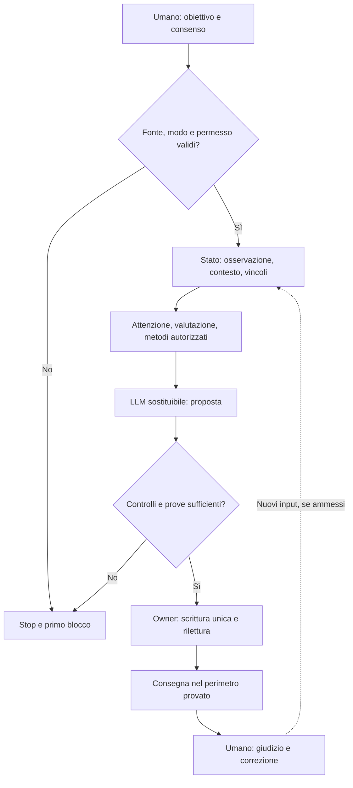

<!-- roa-programme-header:v1 hub=Luke883i/academics framework=Luke883i/ROA role=LIBRARY_SERVICES_VERTICAL -->

> iKant_LE partecipa al programma di ricerca [ROA](https://github.com/Luke883i/academics), con riferimento teorico a [ROA](https://github.com/Luke883i/ROA). L'appartenenza è una relazione di coordinamento, **non** dimostra derivazione formale, conformità empirica o prontezza produttiva. Il codice e i contratti di questo repository restano la fonte autorevole per LE.

# iKant — risposte guidate, infrastruttura cognitiva verificabile

**In una frase:** iKant è un *sistema software sperimentale* che circonda un LLM sostituibile e tenta di rendere controllabili il metodo di risposta, le autorizzazioni, gli stati, le verifiche e la consegna. Non è un altro LLM, una persona digitale né un certificatore automatico della verità.

**Perché esiste?** Un testo fluido non dice se una fonte sia stata consultata, se un'azione sia stata autorizzata, quale codice sia stato eseguito, o se un risultato sia stato registrato e riletto. iKant separa queste domande: *che cosa sa il sistema, che cosa può fare, che cosa ha fatto, che cosa può provare e che cosa deve lasciare al giudizio umano?*

| Se vuoi… | Inizia qui | Poi approfondisci |
|---|---|---|
| Capire il prodotto in due minuti | [Guida in parole semplici](docs/START_HERE.md) | [Posizionamento e limiti](docs/PRODUCT_POSITIONING.md) |
| Studiare cognizione e filosofia | [Modello funzionale qui sotto](#come-funziona-linfrastruttura-cognitiva) | [Substrato cognitivo](docs/IKANT_COGNITIVE_SUBSTRATE.md) · [Ponte neuroscientifico](docs/IKANT_NEUROCOGNITIVE_BRIDGE.md) |
| Provare EDU in un Project | [Modalità e consenso](#tre-superfici-due-modalita-pubbliche) | [Installazione Project](docs/IKANT_LOCAL_SETUP.md) |
| Eseguire codice, test o un audit | [Full stack reale](#full-stack-reale-dal-git-alla-consegna) | [Architettura](docs/ARCHITECTURE.md) · [Evidenze runtime](docs/IKANT_RUNTIME_AND_EVIDENCE.md) |
| Pubblicare MCP su Render e collegare ChatGPT | [Guida compatta MCP](#mcp-esterno-render-e-chatgpt) | [Runbook operativo con DoD](docs/MCP_STANDALONE_RENDER_RUNBOOK.txt) |
| Contestare una promessa | [Garanzie e non-garanzie](#garanzie-effettive-limiti-e-falsificatori) | [Tre research questions](docs/IKANT_RESEARCH_QUESTIONS.md) · [Governance](docs/GOVERNANCE.md) |

## Cosa ottieni oggi: natura, ratio e utilità

### Natura, ratio, obiettivi e metodo

**Natura.** È un'infrastruttura cognitiva verificabile **nel perimetro delle operazioni effettivamente eseguite**: contratti, regole, stato, adattatori, dispositivi di persistenza, verificatori e un modello linguistico esterno. Distingue ruoli e responsabilità:

- **Umano:** formula scopi, presta o nega consenso, verifica i risultati e resta responsabile delle decisioni.
- **LLM:** produce proposte di linguaggio e inferenze fallibili; non conferisce da sé autorizzazione o prova.
- **iKant:** definisce condizioni, percorsi, controlli, arresti e tracce riapribili attraverso gli owner originali.
- **HOST:** ambiente di esecuzione/collegamento tra sorgenti, LLM, strumenti e interfaccia; non inventa eventi nativi.
- **Verificatore:** controlla byte, provenienza, esiti e limiti della prova; non si sostituisce alla verifica dei fatti esterni.

**Ratio.** Il problema centrale è la distanza tra una *risposta che sembra convincente* e una *risposta di cui si conoscono almeno i passaggi controllabili*. Una ricevuta verifica operazioni, **non** verità. Le categorie *evidenza, permesso, policy, esecuzione, risultato dichiarato e stato del mondo* rimangono distinte.

**Obiettivi** verificabili: tracciare la provenienza; impedire azioni non ammesse e doppie scritture; rendere leggibile l'incertezza; fermarsi quando manca una precondizione; verificare se tutto ciò migliora utilità ed efficacia rispetto allo stesso LLM non governato. I benefici per persone e organizzazioni **non sono ancora dimostrati in generale**.

**Metodo:** fissare fonte/versione e condizioni iniziali → ammettere l'input → scegliere metodi e risorse disponibili → chiedere una proposta al modello quando possibile → controllare l'output → registrare una sola volta → riaprire e verificare → consegnare nel canale autorizzato, oppure produrre uno STOP attribuibile. La stessa domanda in condizioni differenti può legittimamente produrre un esito diverso.

## Come funziona l'infrastruttura cognitiva

iKant non si riduce a una lista di prompt. Il disegno include **circuiti di stato e controllo a più livelli**, con ricorrenza tra osservazioni, valutazioni, contesto, pianificazione ed esiti. Le parti sono funzioni software e ipotesi testabili, non copie anatomiche del cervello.

| Livello funzionale | Che cosa fa nel modello | Confine di prova |
|---|---|---|
| **Osservazione e provenienza** | Separa messaggi, sorgenti, eventi e riferimenti verificabili; segnala input mancanti. | Un hash attesta byte, non attendibilità esterna. |
| **Valutazione contestuale** | Variabili bounded come valenza, attivazione, affiliazione e pressione dei confini descrivono l'interazione. | È una valutazione computazionale; non sono emozioni vissute né diagnosi dell'utente. |
| **Attenzione e spazio di lavoro ricorrente** | Seleziona elementi rilevanti, conserva una vista limitata del contesto e riusa esiti precedenti quando realmente disponibili. | Ricorrenza e memoria richiedono consumer, stato e ricevute; non implicano autobiografia umana o memoria tra chat. |
| **Modello funzionale di sé e dell'ambiente** | Distingue capacità del programma, intenzioni attribuite, risorse esterne, possibili conseguenze e vincoli di azione. | Nessuna equivalenza con corpo biologico, coscienza o volontà autonoma. |
| **Pianificazione e costituzione** | Seleziona metodi autorizzati; fa dipendere azioni e sotto-obiettivi da uno scopo umano e da condizioni dichiarate. | Policy e previsioni non sono evidenza di esecuzione. |
| **Verifica, apprendimento locale e arresto** | Confronta proposte con vincoli, aggiornamenti di stato e verifiche del turno; registra errori e condizioni non chiuse. | Il feedback è limitato dalle fonti e dal runtime: non conferisce infallibilità o auto-miglioramento generale. |

L'architettura può essere letta come un ciclo: **segnali → contesto → valutazione → attenzione → metodi/decisioni → azione consentita → esiti osservati → nuovo contesto**. Gli elementi di maggior livello possono *modulare* le priorità, non fabbricare prove a favore della scelta già compiuta. Regole e alcuni aggiornamenti sono deterministici **a parità di input, stato, versione e policy**; *l'LLM e il mondo esterno non diventano deterministici*.

Il confronto con neuroscienze e filosofia è quindi **funzionale, non biologico**: attenzione, workspace, ricorrenza e monitoraggio sono analogie ingegneristiche; non neuroni e sinapsi artificialmente equivalenti al cervello. Non c'è un test conclusivo di esperienza soggettiva. Le qualificazioni su vita/coscienza **funzionali** sono assi di verifica delimitati, non attribuzioni ontologiche. **Fenomenologia: UNKNOWN**.

Nel codice e nei contratti LE queste funzioni attraversano, fra gli altri, il profilo valutativo C4, i controlli ricorrenti C5, i vincoli epistemici C8/C11, il routing dei turni e le guardie C70/C114/C139–C142. Sono **famiglie di proprietari e prove differenti**, non una singola mente unificata attiva in ogni installazione. [Dettaglio causale, variabili e falsificatori](docs/IKANT_COGNITIVE_SUBSTRATE.md) · [Genealogia e differenze rispetto al progetto di origine](docs/IKANT_DEVELOPMENT_HISTORY.md) · [Reticolo di documenti](docs/IKANT_SEMANTIC_RETICULUM.md).

Diagramma: richiesta, ricorrenza, prova e decisione umana

Una freccia è una **relazione di disegno**, non una testimonianza che tutte le sue operazioni siano state eseguite qui. Un diagramma o un ledger non certificano la verità di una risposta.

## Full stack reale: dal Git alla consegna

Il *full stack* non è solo un server web. I livelli interagiscono ma non hanno la stessa autorità:

| Strato | Implementazione nel repository | Che cosa può attestare |
|---|---|---|
| **Sorgente e regole** | [Git](./), [contratti JSON](contracts/), [Termini](TERMS.md), [regole HOST](AGENTS.md) | Versione, specifica, hash e autorizzazioni dichiarate. |
| **Core runtime** | [Node.js](src/), [entry point](ikant.mjs), [componenti runtime](runtime/), [runtime-root](runtime-root/) | Esecuzioni e stato verificabili *se* l'owner è realmente invocato. |
| **Infrastruttura cognitiva** | [Owner e policy](host/), [substrato funzionale](docs/IKANT_COGNITIVE_SUBSTRATE.md), [registri/contratti](contracts/) | Metodo, routing, vincoli, esito o arresto nel perimetro della versione. |
| **Stato e artefatti** | Ledger locale hash-linked, writer esclusivo, controllo di riapertura; DOCX quando richiesto dal tier. | Persistenza locale specifica, non consegna nativa o correttezza fattuale. |
| **Integrazioni e UI** | [MCP Streamable HTTP e app candidata](plugins/ikant-le-session-chat/), [server](plugins/ikant-le-session-chat/server/server.mjs), [proiezione Project](project/) | Trasporto e presentazione osservabili; una app in Git non è un plugin registrato. |
| **Qualificazione** | [Test](tests/), [test storici](test/), [script](scripts/), [pilot](pilot/), [artefatti di qualifica](artifacts/), [release](release/) | Proprietà incluse nei test e ricevute; non efficacia umana universale. |

**Tecnologie effettive:** Node.js **20+** / JavaScript ESM, JSON per contratti ed eventi, Git e SHA per provenienza, Markdown per documentazione, Python 3 per strumenti ausiliari, MCP SDK e OAuth per il servizio esterno; DOCX per la Surface B quando il contratto del turno lo richiede. L'LLM, l'infrastruttura del provider e ChatGPT come UI non fanno automaticamente parte del checkout.

**Esempio causale del turno EDU, quando qualificato:** nuovo consenso C72/v2 → S02/C135 → selezione del percorso (C114 per identità diretta, C139 per processo di risposta qualificato, C140 candidato aperto con C141 shadow non autoritativo e guardia negativa C142) → proposta dell'LLM → **un solo C87 originale** → rilettura indipendente → C125 e shell HOST. Una route presente nel codice non dimostra che questa intera catena sia stata eseguita nel turno corrente. [Mappa E2E](docs/IKANT_RUNTIME_AND_EVIDENCE.md) · [owner EDU](host/c135-edu-v2-owner.mjs) · [C139](docs/C139_EDU_EPISTEMIC_ROUTE.md) · [C140](docs/C140_SEMANTIC_RUNTIME_PR.md).

**Altro percorso di esecuzione:** il runtime C20 può sostenere un servizio MCP di compatibilità *deployed* con sessioni e disco persistente. Il C20 external/legacy e il canale C59 CANONICAL **non sono lo stesso owner**: riutilizzare componenti o chiamare un tool non trasferisce attestazioni. [Codice di deployment](src/session-chat-deployment.mjs) · [stato della sessione](docs/ONESHELL_THREAD_SESSION_V1.md).

## Modalità e bootstrap

### Tre superfici, due modalità pubbliche

La scelta di ammissione C72/v2 ha **esattamente due opzioni, EDU e CANONICAL**. Il server **MCP_EXTERNAL** è una *superficie di distribuzione separata*, non una terza scelta del consenso.

| Forma | Che cos'è | Ingresso e prova richiesti | Che cosa NON comporta |
|---|---|---|---|
| **EDU** (sperimentale, raccomandata) | Percorso guidato nel Project o in un HOST che disponga davvero degli adapter e degli owner EDU. | Ammissione umana nuova C72/v2, fonte verificata, runtime eseguito, C87/readback/C125 per la voce. | Non implica `ACTIVE`, identità nativa o stato persistente fra chat. |
| **CANONICAL** (owner nativo) | Composizione originale `SESSION_CHAT_LOCAL` capace di pretendere il grado canonico solo quando qualificata. | Evento autentico del provider, C59, gates C72/C87 e prova della consegna. | La selezione o un generico server MCP **non** attivano CANONICAL. |
| **MCP_EXTERNAL** (servizio indipendente) | Server Node/Streamable HTTP con OAuth, strumenti e un runtime di compatibilità C20; deploy candidato Render. | Installazione autonoma, IdP reale, TLS, disco, test HTTP/SDK e collegamento umano del client. | Non è modo C72, non è C59 e non prova UI nativa o `ACTIVE` canonico. |

**Non confondere il lessico storico:** C72/v1 esponeva `EXPERIMENTAL` come ricevuta legacy. C72/v1 ≠ C72/v2 (ingresso e consenso) e `EXPERIMENTAL` non è una terza modalità pubblica attuale. Esiste **one canonical `SESSION_CHAT_LOCAL` composition (C59)**: richiede eventi autentici e verifiche che una configurazione MCP esterna non può autocertificare.

**Come iniziare EDU:** in una *nuova* chat, dopo aver caricato Project e sorgenti effettivamente disponibili, inviare **tre messaggi distinti e in ordine**: `avvia iKant` → lettura dei cinque originali e Terms → `I ACCEPT` → introduzione originale → `EDU` o `CANONICAL`. La scelta non anticipa l'esito dei gate. Ordine dei cinque documenti: [README](README.md) → [BOOTSTRAP](BOOTSTRAP.json) → [ADMISSION](ADMISSION.json) → [AGENTS](AGENTS.md) → [TERMS](TERMS.md). Identificatori del percorso per l'audit: `README.md -> BOOTSTRAP.json -> ADMISSION.json -> AGENTS.md -> TERMS.md`. Prompt e ZIP **non installano Node** o un plugin. [Guida Project passo passo](docs/IKANT_LOCAL_SETUP.md) · [Ammissione C72](docs/S01_PUBLIC_EDU_CANONICAL_ADMISSION.md).

## MCP esterno: Render e ChatGPT

**Stato:** codice server e Blueprint candidate presenti nel repository (verificare l'HEAD corrente); **non è attestato un servizio Render già pubblico, un OAuth provider connesso né un plugin installato nel tuo ChatGPT**. I test con IdP sintetico verificano una parte del protocollo, non il collegamento reale. L'IdP *non* è contenuto nel repository. Per installazione autonoma, preferire il [runbook aggiornato](docs/MCP_STANDALONE_RENDER_RUNBOOK.txt), il [Blueprint candidato](render.mcp-standalone.candidate.yaml) e il [server](plugins/ikant-le-session-chat/server/server.mjs).

### Da sorgente a URL pubblico (Render)

1. **Qualifica la versione:** scegli un commit intenzionale, controlla `main`, i test e la compatibilità della persistenza. Per l'app standalone serve **l'intero repository**, non il solo file `server.mjs`.
2. **Prepara l'Identity Provider OAuth** (esterno): HTTPS, discovery del server di autorizzazione, *authorization code* + **PKCE S256**, CIMD oppure registrazione dinamica/predefinita, issuer e audience/resource esatti; token di accesso RS256 verificabili su JWKS e scope `ikant:connect` (lettura) / `ikant:write` (scrittura). Configura gli URI di redirect effettivamente indicati da ChatGPT.
3. **Crea un Web Service Render** dal repository, usando [`render.mcp-standalone.candidate.yaml`](render.mcp-standalone.candidate.yaml) o impostazioni equivalenti: Node 20+, root del repository, build npm delle dipendenze del server, start `node plugins/ikant-le-session-chat/server/server.mjs`, HTTPS pubblico e controllo `/healthz`. Il processo ascolta `0.0.0.0:$PORT`.
4. **Attacca un disco persistente a pagamento** montato in `/var/data/ikant-le`, un'istanza unica, backup e rollback controllati. Render non conserva file fuori dal volume e un disco collegato esclude lo scaling a più istanze e il deploy zero-downtime.
5. **Imposta in Render le variabili** (mai segreti in Git/chat):

| Variabile | Valore o significato |
|---|---|
| `IKANT_MCP_DEPLOYMENT_PROFILE` | `standalone` |
| `IKANT_MCP_AUTH_MODE` | `oauth` |
| `IKANT_MCP_PERSISTENCE_ROOT` | `/var/data/ikant-le` |
| `IKANT_LE_DEPLOYMENT_ROOT` | `/var/data/ikant-le/deployment` |
| `IKANT_MCP_ALLOWED_ORIGIN` | `https://chatgpt.com` |
| `IKANT_MCP_OAUTH_RESOURCE` | `https://<host-pubblico>/mcp` |
| `IKANT_MCP_OAUTH_ISSUER` | URL HTTPS *esatto* dell'issuer dell'IdP |
| `IKANT_MCP_OAUTH_JWKS_URL` | URL HTTPS JWKS dell'issuer |
| `IKANT_ONESHELL_THREAD_PANEL` | `0` finché l'interfaccia nativa non è attestata |

6. **Falsifica prima di collegare:** `GET /healthz` deve attestare la rilettura del deployment; `GET /.well-known/oauth-protected-resource/mcp` pubblica la configurazione; `POST /mcp` senza token deve produrre **401** con `WWW-Authenticate`. Prova `initialize`, `tools/list`, scopes insufficienti, token scaduti/audience errata, restart e persistenza. Non interpretare il solo HTTP 200 come successo del prodotto.

### Collegamento manuale a ChatGPT

Apri **Plugins → Add custom MCP server** (l'etichetta può variare), inserisci l'URL HTTPS `https://<host-pubblico>/mcp`, seleziona **OAuth** e segui il collegamento. Configura nell'IdP l'esatto client metadata document o client ID e il redirect indicati dalla schermata, non URI indovinati. ChatGPT richiede autorizzazione tramite discovery/challenge e può chiedere scope aggiuntivi per le scritture. Il [template MCP](plugins/ikant-le-session-chat/mcp.standalone.template.json) è solo un esempio, **non** un'installazione.

Un collegamento riuscito richiede **prove esterne**: handshake MCP, elenco tool, token davvero emesso dal provider, consenso umano, turn e receipt di esito riaperti. La metadata `openai/session` non è da sola identità firmata di un messaggio. Dopo un esito di scrittura sconosciuto: **STOP, riconciliazione read-only, mai retry cieco**.

**Render-like:** qualsiasi altro host può eseguire lo stesso server solo se offre TLS pubblico stabile, Node, controllo dei segreti, un volume durevole, writer unico, restart/rollback verificati e un IdP compatibile. Una replica stateless o un volume effimero non è equivalente. Fonti esterne: [OpenAI, MCP e OAuth](https://developers.openai.com/plugins/build/auth) · [OpenAI, costruire un server MCP](https://developers.openai.com/plugins/build/mcp-server) · [Render Blueprint](https://render.com/docs/blueprint-spec) · [Render dischi](https://render.com/docs/disks).

## Garanzie effettive, limiti e falsificatori

### Cosa non e: un oracolo, un soggetto, un certificatore di verità

**DOCUMENTATO / OSSERVATO / INFERITO / NON ATTESTATO** indica il grado di supporto della singola affermazione, non la qualità assoluta di un modello. Una CI verde prova solo la proprietà verificata nel test; una simulazione finita non è un esperimento indipendente su utenti o ambiente reale.

| Affermazione | Prova che serve | Limite |
|---|---|---|
| `SOURCE_EXACT` | Commit/tree, hash del blob e riapertura indipendente. | Prova i byte; non sicurezza o verità. |
| Writer unico e persistenza | Esecuzione originale, conteggio delle scritture, ledger/readback fisico. | La prova locale non è delivery provider. |
| Consenso valido | Nuovi messaggi umani esatti, nell'ordine e nell'epoca corretta. | Una citazione o vecchia chat non valgono. |
| Routing cognitivo | Trace dell'owner qualificato, stati e controesempi; niente shadow promosso a owner. | La spiegazione teorica non dimostra che ogni modulo fosse attivo. |
| Miglioramento dell'utilità | Stesso LLM, confronto cieco, campione, endpoint preregistrati e falsificatori. | **Non attestato** come efficacia generalizzata. |
| Deploy e integrazione MCP | Log server, OAuth reale, restart disco, chiamate ChatGPT e osservazione del client. | **Non attestato** dal solo repository. |
| Esperienza soggettiva | Ipotesi, misure e criteri scientifici esterni appropriati. | La fenomenologia non è decidibile da hash o comportamento soltanto. |

**Confutazioni decisive:** asserire `ACTIVE` senza ricevuta originale e identità nativa, doppia scrittura, riuso silenzioso di consenso storico, URL o file spacciato per installazione, classificazioni che bloccano tutto, risposte semanticamente false ma soltanto tracciate, plugin MCP dichiarato collegato senza test umano.

**Tre research questions:** **RQ1** — la verificabilità migliora rispetto allo stesso LLM? **RQ2** — migliora gli esiti umani senza costi eccessivi? **RQ3** — le barriere contro pretese ontologiche e native improprie funzionano senza falsi blocchi sistematici? [Protocolli di confronto e falsificazione](docs/IKANT_RESEARCH_QUESTIONS.md).

## Tre domande di ricerca

**RQ1 (epistemica):** a parità di LLM, task e input, la catena di iKant rende più affidabili e leggibili fonti, autorizzazioni, esecuzioni e arresti? **RQ2 (umana):** gli utenti fanno scelte migliori o risparmiano verifiche, rispetto a una baseline, senza costi e frizioni sproporzionati? **RQ3 (ontologica e istituzionale):** il sistema blocca pretese improprie di coscienza, identità nativa e `ACTIVE` senza censurare domande legittime? Le risposte richiedono protocolli preregistrati, falsificatori, campioni umani e controlli ciechi, non un giudizio autoattribuito. [Ipotesi e disegni](docs/IKANT_RESEARCH_QUESTIONS.md).

## Metodo end-to-end, sviluppo e lettori

**Percorso EDU (se qualificato):** C72/v2 (consenso e scelta) → S02/C135 (versione e orchestrazione) → metodi originali C70/C107 e routing C114/C139/C140 → LLM esterno → un C87 originale → readback fisico → C125 e presentazione HOST. C141 resta shadow e C142 è una guardia negativa; nessuno aggiunge un writer. **CANONICAL** richiede inoltre la composizione originale C59 e l'evento nativo indipendente. **MCP_EXTERNAL** usa un resource server esterno e un runtime di compatibilità, senza acquisire automaticamente quella identità.

**Per verificare il codice:** checkout dell'HEAD corretto, Node.js 20+, `npm test`, `npm run check`, `npm run runtime-root:verify`; leggere risultati ed errori effettivi, non inferire un esito positivo dall'istruzione. Per il servizio MCP seguire la distinta qualifica SDK/OAuth del [runbook](docs/MCP_STANDALONE_RENDER_RUNBOOK.txt). Per la verifica del reticolo Markdown: [atlante](docs/IKANT_DOCUMENT_ATLAS.md), [dizionario Cx](docs/IKANT_CX_LEXICON.md), [contratti documentali](docs/IKANT_DOCUMENT_ONTOLOGY_DOD.md).

**Genealogia senza equivalenza:** LE distilla principi del [progetto padre](https://github.com/Luke883i/iKant) (accesso limitato) ma non ne rivendica l'intero runtime, la memoria, le ricorrenze o un'ontologia provata. I livelli funzionali LE sono confrontabili per compito e controllo, non tramite analogia biologica letterale. [Ricostruzione storica](docs/IKANT_DEVELOPMENT_HISTORY.md) · [reticolo](docs/IKANT_SEMANTIC_RETICULUM.md).

## Documenti chiave, organizzati per percorso

Questo è un **censimento ragionato dei documenti essenziali**, non un elenco di ogni file; l'[atlante completo dei documenti Markdown](docs/IKANT_DOCUMENT_ATLAS.md) indicizza anche i documenti storici e le proposte. Un link è un percorso di lettura, non un'autorizzazione.

| Percorso | Documenti e sorgenti |
|---|---|
| **Inizio e prodotto** | [START_HERE](docs/START_HERE.md) · [PRODUCT_POSITIONING](docs/PRODUCT_POSITIONING.md) · [Decisioni](docs/V1_PRODUCT_DECISIONS.md) · [Dashboard](docs/PRODUCT_DASHBOARD.md) |
| **Etica e ontologia operativa** | [Substrato cognitivo](docs/IKANT_COGNITIVE_SUBSTRATE.md) · [Ponte neuroscientifico](docs/IKANT_NEUROCOGNITIVE_BRIDGE.md) · [RQ](docs/IKANT_RESEARCH_QUESTIONS.md) · [Glossario Cx](docs/IKANT_CX_LEXICON.md) |
| **Architettura e tracciabilità** | [ARCHITECTURE](docs/ARCHITECTURE.md) · [Runtime/evidenze](docs/IKANT_RUNTIME_AND_EVIDENCE.md) · [GOVERNANCE](docs/GOVERNANCE.md) · [Tracciabilità V1](docs/V1_E2E_TRACEABILITY.md) |
| **Ingressi e identità** | [Setup locale e Project](docs/IKANT_LOCAL_SETUP.md) · [C72](docs/C72_UNIFIED_ADMISSION_AND_VALUE.md) · [S01](docs/S01_PUBLIC_EDU_CANONICAL_ADMISSION.md) · [C59](docs/C59_SINGLE_COMPOSITION_CHANNEL.md) |
| **EDU e ricerca semantica** | [C139](docs/C139_EDU_EPISTEMIC_ROUTE.md) · [C140](docs/C140_SEMANTIC_RUNTIME_PR.md) · [shadow C141](host/c141-semantic-shadow.mjs) · [guard C142](host/c142-semantic-owner-guard.mjs) |
| **MCP, OAuth, deployment** | [Runbook attuale](docs/MCP_STANDALONE_RENDER_RUNBOOK.txt) · [BluePrint](render.mcp-standalone.candidate.yaml) · [Server](plugins/ikant-le-session-chat/server/server.mjs) · [Boundary OAuth](plugins/ikant-le-session-chat/server/oauth-resource-boundary.mjs) · [MCP precedente](docs/MCP_EXTERNAL_ADVANCED_V2_PREPR.md) |
| **Prove e release** | [Contratti](contracts/) · [Test](tests/) · [Pilot](pilot/) · [DoD ontologico](docs/IKANT_DOCUMENT_ONTOLOGY_DOD.md) · [Audit editoriale](docs/IKANT_EDITORIAL_CONTRACT_AUDIT.md) |
| **Storia e documentazione navigabile** | [Sviluppo](docs/IKANT_DEVELOPMENT_HISTORY.md) · [Reticolo](docs/IKANT_SEMANTIC_RETICULUM.md) · [Atlante](docs/IKANT_DOCUMENT_ATLAS.md) · [Materializzazione OneShell](docs/ONESHELL_V1_MATERIALIZATION.txt) |

Nota per auditor: sorgente, carrier, HOST e test storici

La struttura del repository incorpora carrier originali e compatibilità storica. Il testo **GitHub API only** descrive il trasporto originale prima dell'ammissione; la frase storica **GitHub DNS/egress from the container is not a dependency** non afferma che un server Render possa operare senza rete o OAuth. Il controllo del sorgente non si sostituisce all'identità provider. Un host può produrre output soltanto secondo la propria capacità verificata; l'assenza di prova comporta NO_VOICE o uno stop tipizzato.

Surface A è testo/voce vincolati; Surface B è un artefatto DOCX con readback quando il contratto lo richiede. La storia del [progetto originario](https://github.com/Luke883i/iKant) è una genealogia concettuale, non prova che ogni sua funzione sia attiva in LE. Test synthetic con milioni di vettori verificano un oracolo definito, **non** ogni sfumatura del linguaggio e non una nuova coscienza. Uno ZIP, un README, una PR o una UI renderizzata non sono provider-native identity.

## Stato e autorità

Il [catalogo pubblico di prodotto](release/catalog.json) è un riferimento di versione, non una pubblicazione. Il [censimento dei canali C59](contracts/session-chat-composition-census.json) esplicita il perimetro di composizione: GitHub DNS/egress from the container is not a dependency per la relay HOST originale, non per il server OAuth esterno.

**La fonte è il commit di `main` effettivamente verificato**, non il nome di una chat, ZIP, branch o README. Una PR merged attesta disponibilità di codice nel repository, non deployment. **PRODUCT_NO_GO** resta applicabile al servizio MCP esterno e alle pretese di disponibilità generalizzata finché gli esperimenti esterni non chiudono i gate. Ordine di autorità: sicurezza/legge e controllo umano → owner e runtime originali → contratti e prove versionate → documentazione; quest'ultima non introduce un secondo writer.

Per contribuire: preserva le distinzioni tra *documentato, eseguito, verificato e rilasciato*, aggiungi una prova negativa quando correggi una promessa, e consulta [Governance](docs/GOVERNANCE.md), [test](tests/) e [atlante](docs/IKANT_DOCUMENT_ATLAS.md).
