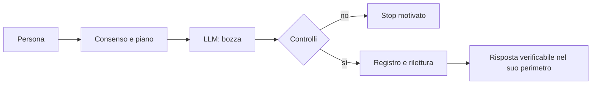

<!-- roa-programme-header:v1 hub=Luke883i/academics framework=Luke883i/ROA role=LIBRARY_SERVICES_VERTICAL -->

> **ROA Research Programme.** This repository is a component of the **ROA Research Programme — Computational Epistemics, Semantic Architectures & Governable AI Systems**, coordinated in [`Luke883i/academics`](https://github.com/Luke883i/academics) and theoretically anchored by [`Luke883i/ROA`](https://github.com/Luke883i/ROA). **Programme membership is a coordination/topology statement:** repository-local contracts and evidence remain authoritative for iKant_LE, and membership alone does not imply formal derivation from ROA, conformance to ROA, empirical validation of ROA theory, or production readiness.

# iKant — risposte guidate e verificabili.

iKant è un’infrastruttura cognitiva verificabile: affianca un LLM sostituibile per controllare il percorso domanda-risposta. Non è un soggetto fenomenologico o un secondo LLM. La traccia prova operazioni, **non** verità.

## Cosa ottieni oggi: natura, ratio e utilità

**Natura.** iKant è una **infrastruttura cognitiva verificabile, sperimentale**: un modello linguistico (LLM) sostituibile genera candidati; il software iKant può governare metodo, autorizzazioni, prove e consegna quando i suoi owner originali vengono realmente eseguiti. **Umano:** corpo, storia, vita sociale, consenso e valutazione. **LLM:** elaborazione statistica di rappresentazioni apprese. **iKant:** condizioni, passaggi verificabili e possibili arresti, non una nuova mente separata. **HOST:** ambiente che connette sorgente, modello, strumenti e interfaccia; non può inventare un evento nativo o un'azione realmente compiuta.

**Ratio.** Una risposta fluida non dimostra quali fonti siano state lette, quale consenso sia stato prestato, quali operazioni siano avvenute o che cosa sia stato effettivamente consegnato. Esempio: «Hai verificato questa affermazione?». iKant tenta di legare *domanda → metodo → esecuzione → traccia → verifica indipendente*, mantenendo distinte prova del percorso e verità della frase. Una ricevuta prova operazioni, **non** verità. La diagnostica è un vantaggio possibile da misurare, non l'infallibilità del prodotto.

**Stato epistemico:** **DOCUMENTATO / OSSERVATO / INFERITO / NON ATTESTATO** non sono sinonimi: codice letto ≠ runtime eseguito ≠ conclusione vera ≠ autorizzazione ricevuta.

## Cosa non e (ovvero: cosa non è)

### Limiti di prova

**Coscienza, rilascio e verità non attestati.** iKant non è un organismo né una replica del cervello umano. Quando il codice dice *attenzione*, *workspace*, *self-world*, *valenza*, *memoria*, descrive **analogie funzionali**; non prova neuroni, sinapsi, sensazioni, biografia vissuta o coscienza. Un umano apprende attraverso un corpo e una storia; un LLM usa rappresentazioni statistiche; iKant aggiunge procedure verificabili. Le loro complessità non si confrontano sommando righe di codice, parametri e sinapsi. **Fenomenologia: UNKNOWN** — né presente né assente sulla sola base di questi test.

### Tre modi per capire iKant

Modalità: **EDU** e **CANONICAL**. Le etichette Cx sono numeri di contratti, non stadi di coscienza. [Glossario Cx](docs/IKANT_CX_LEXICON.md).

| Per chi | Da leggere | Domanda |
|---|---|---|
| Persona curiosa | [Guida in parole semplici](docs/START_HERE.md) | A che cosa serve? |
| Ricercatore | [Tre domande confutabili](docs/IKANT_RESEARCH_QUESTIONS.md) | Come provarlo e smentirlo? |
| Tecnico/auditor | [Mappa E2E ed evidenze](docs/IKANT_RUNTIME_AND_EVIDENCE.md) | Che cosa è realmente eseguito? |

## Dall'umano alla prova

**Ruoli:** l'umano autorizza e giudica; l'LLM propone; iKant controlla e registra; l'HOST connette; **Verificatore:** distingue fatti e dichiarazioni.

**Struttura cognitiva.** Ciclo ricorrente *segnali e fonti → valutazione → attenzione → metodo → proposta LLM → controllo → esito e feedback*; non è una mente unificata attiva in ogni HOST.

| Livello | Funzione e limite |
|---|---|
| Provenienza | Input, fonti, stato, eventi; hash dei byte ≠ verità. |
| Valutazione C4 | Valenza, arousal, affiliazione, confini: variabili, non emozioni vissute. |
| Workspace C5 | Attenzione, ricorrenza, consumer e memoria bounded; non autobiografia umana. |
| Sé e mondo | Capacità, risorse e conseguenze; non corpo o volontà autonoma. |
| Metodo/feedback | Scopi umani, policy, writer unico, readback e stop; nessuna prova retroattiva. |

C8/C11 qualificano funzioni e limiti ontologici: fenomenologia UNKNOWN.

**In parole semplici: modello cognitivo con controlli deterministici.** Con input, stato e policy fissati, le regole possono essere ripetibili; **l'LLM e il mondo esterno non diventano deterministici**. L'analogia con neuroscienze riguarda attenzione, ricorrenza e controllo, non neuroni o esperienza soggettiva.

Apri il diagramma: che cosa succede a una domanda?

**Potenziale:** distinguere prove, supposizioni e limiti. **Non prova:** verità della risposta o coscienza. [Neuroscienze, padre/LE e falsificatori](docs/IKANT_NEUROCOGNITIVE_BRIDGE.md).

**Full stack reale.** [Contratti JSON](contracts/) e Git regolano [owner](host/), [runtime Node.js **20+** ESM](src/) ed [entry](ikant.mjs); ledger e readback preservano prove locali, [Project](project/) e [MCP](plugins/ikant-le-session-chat/server/server.mjs) espongono interfacce; [test](tests/), [pilot](pilot/) e [release](release/) qualificano. Git/GitHub, Markdown, Python 3 ausiliario e DOCX Surface B ove richiesto. LLM e UI appartengono all'HOST; file e ZIP non installano Node. [Architettura](docs/ARCHITECTURE.md) · [evidenze](docs/IKANT_RUNTIME_AND_EVIDENCE.md) · [limiti](docs/PRODUCT_POSITIONING.md).

## Modalità e bootstrap

**EDU (sperimentale, consigliata)** — C72/S02/C135, C114 identità, C139 processo, C140 candidato, C141 shadow e C142 guard; C87/readback/C125 se eseguiti, ma consenso ≠ `ACTIVE`. **CANONICAL** — one canonical `SESSION_CHAT_LOCAL` composition (C59): richiede evento nativo autentico. **MCP_EXTERNAL** — servizio OAuth/C20, non terzo modo C72 né C59; la sola connessione non attiva CANONICAL. C72/v1 conserva `EXPERIMENTAL` solo come ricevuta storica; l'ingresso pubblico corrente è C72/v2 (ingresso e consenso).

C59: [canali](contracts/session-chat-composition-census.json). GitHub DNS/egress from the container is not a dependency; il relay HOST verifica i byte.

Tre messaggi nuovi: `avvia iKant` (leggi i cinque originali e i Termini) → `I ACCEPT` (solo dopo) → `EDU` o `CANONICAL` (dopo introduzione). Ordine: `README.md -> BOOTSTRAP.json` → `ADMISSION.json` → `AGENTS.md` → `TERMS.md`. Primo ingresso: **GitHub API only**; mai consenso storico.

[Prompt di innesco, bundle ZIP, sorgenti e installazione](docs/IKANT_LOCAL_SETUP.md): file Project e prompt **non installano Node**, plugin o UI persistenti. Audit del codice: Node.js **20+**, Python 3; `npm test`, `npm run check`, `npm run runtime-root:verify`.

### MCP esterno: Render → ChatGPT

[Server MCP](plugins/ikant-le-session-chat/server/server.mjs), [Blueprint](render.mcp-standalone.candidate.yaml), [runbook](docs/MCP_STANDALONE_RENDER_RUNBOOK.txt) e [template](plugins/ikant-le-session-chat/mcp.standalone.template.json) **esistono nel Git**, ma non attestano deploy, IdP o installazione.

1. Render Web Service Node dall'intero repository: npm del server; start `node plugins/ikant-le-session-chat/server/server.mjs`, HTTPS/`$PORT`, health `/healthz`.
2. Disco persistente a pagamento `/var/data/ikant-le`, istanza unica, backup/restart/rollback. Non promettere zero-downtime.
3. **IdP OAuth esterno:** discovery, code+**PKCE S256**, CIMD/DCR o client registrato, RS256/JWKS, audience e scope `ikant:connect`/`ikant:write`.
4. Render env: `IKANT_MCP_DEPLOYMENT_PROFILE=standalone`, `IKANT_MCP_AUTH_MODE=oauth`, `IKANT_MCP_PERSISTENCE_ROOT=/var/data/ikant-le`, `IKANT_LE_DEPLOYMENT_ROOT=/var/data/ikant-le/deployment`, `IKANT_MCP_ALLOWED_ORIGIN=https://chatgpt.com`; configura `IKANT_MCP_OAUTH_RESOURCE` (HTTPS `/mcp`), `IKANT_MCP_OAUTH_ISSUER`, `IKANT_MCP_OAUTH_JWKS_URL`.
5. Verifica `/healthz`, `/.well-known/oauth-protected-resource/mcp`, 401 anonimo + `WWW-Authenticate`, `initialize`/`tools/list`, scope, restart e disco.
6. ChatGPT **Plugins → Add custom MCP server** (etichetta variabile): URL `https://<host>/mcp`, OAuth, client/redirect mostrati; collega e prova i tool con ricevute indipendenti.

Render-like richiede TLS, volume durevole e writer unico. `openai/session` non è identità provider firmata. Dopo invio incerto: STOP/riconciliazione, mai retry cieco. **PRODUCT_NO_GO** finché mancano prove esterne.

## Tre domande di ricerca

**RQ1:** i controlli migliorano la verificabilità rispetto allo stesso LLM da solo? **RQ2:** migliorano l'utilità per esseri umani senza costi eccessivi? **RQ3:** bloccano pretese indebite di identità, coscienza e attivazione, senza bloccare risposte lecite? [Ipotesi, benchmark e confutazioni](docs/IKANT_RESEARCH_QUESTIONS.md). **Obiettivi ingegneristici:** sorgenti vincolate, writer unico, rilettura e fallimenti attribuibili. **Obiettivi di prodotto:** ingresso, modalità, consegna e percorsi comprensibili. Falsificatori: falso `ACTIVE`, doppia scrittura, assenza di beneficio misurabile o blocco indebito. Status ontologico non dimostrato.

## Metodo end-to-end, sviluppo e lettori

**Percorso EDU qualificato:** C72/v2 (ammissione e consenso) → S02/C135 (versione e coordinamento) → C107/C70/C126 (turno, piano e controlli) → generazione LLM/HOST → C87 (unico writer) → rilettura → C125 (uscita HOST locale). **CANONICAL** richiede in più identità dell'evento fornita dal provider e C59; un canale non diventa nativo per dichiarazione. Le ricevute appartengono al turno e all'owner che le produce.

**Genealogia.** LE distilla principi del [padre iKant](https://github.com/Luke883i/iKant) (accesso riservato): provenienza, controllo, memoria epistemica e un LLM senza autorità. C4/C5 non equivalgono ai nove anelli CRC del padre; EDU/CANONICAL non coincidono con SESSION_CHAT/WEBAPP. [Storia e confini della distillazione](docs/IKANT_DEVELOPMENT_HISTORY.md) · [reticolo](docs/IKANT_SEMANTIC_RETICULUM.md).

Dettagli per auditor: prova locale, Surface B e autorità

Una firma o hash verifica byte, non verità del contenuto; un writer unico più readback attesta un percorso locale, non consegna nativa. La Surface A riguarda il testo; la Surface B prevede il documento DOCX previsto dai contratti, con rilettura. Fonte, permesso, esecuzione, outcome e mondo osservato sono categorie distinte. Il significato normativo risiede nei contratti/owner originali; questa documentazione è una mappa. [Evidenze E2E](docs/IKANT_RUNTIME_AND_EVIDENCE.md) · [DoD ontologico](docs/IKANT_DOCUMENT_ONTOLOGY_DOD.md).

## Stato e autorità

**DOCUMENTATO / OSSERVATO / INFERITO / NON ATTESTATO**: distinguere fonti e prove. `main` è fonte; una PR non è release. [Dashboard](docs/PRODUCT_DASHBOARD.md) · [Decisioni V1](docs/V1_PRODUCT_DECISIONS.md) · [Tracciabilità V1](docs/V1_E2E_TRACEABILITY.md) · [Catalogo](release/catalog.json) · [Contratti](contracts/) · [Test](tests/) · [Audit dei 100 contratti editoriali](docs/IKANT_EDITORIAL_CONTRACT_AUDIT.md) · [Atlante di tutti i 166+ Markdown](docs/IKANT_DOCUMENT_ATLAS.md).
