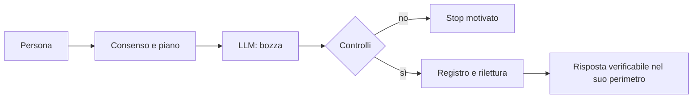

<!-- roa-programme-header:v1 hub=Luke883i/academics framework=Luke883i/ROA role=LIBRARY_SERVICES_VERTICAL -->

> **ROA Research Programme.** This repository is a component of the **ROA Research Programme — Computational Epistemics, Semantic Architectures & Governable AI Systems**, coordinated in [`Luke883i/academics`](https://github.com/Luke883i/academics) and theoretically anchored by [`Luke883i/ROA`](https://github.com/Luke883i/ROA). **Programme membership is a coordination/topology statement:** repository-local contracts and evidence remain authoritative for iKant_LE, and membership alone does not imply formal derivation from ROA, conformance to ROA, empirical validation of ROA theory, or production readiness.

# iKant — risposte guidate e verificabili.

iKant è un’infrastruttura cognitiva verificabile: affianca un LLM sostituibile per controllare il percorso domanda-risposta. Non è un soggetto fenomenologico o un secondo LLM. La traccia prova operazioni, **non** verità.

## Cosa ottieni oggi: natura, ratio e utilità

**Natura.** iKant è una **infrastruttura cognitiva verificabile, sperimentale** intorno a un LLM sostituibile: regola metodo e prove solo quando gli owner sono eseguiti. **Umano:** scopi, consenso, giudizio. **LLM:** proposta statistica fallibile. **iKant:** controlli, esiti e stop. **HOST:** collega sorgente, modello e interfaccia senza inventare eventi nativi.

**Ratio.** Il testo fluido non rivela fonti, autorizzazioni e azioni effettive. iKant lega *domanda → metodo → esecuzione → traccia → verifica indipendente*. Una ricevuta prova operazioni, **non** verità; l'efficacia richiede confronti esterni.

**Stato epistemico:** **DOCUMENTATO / OSSERVATO / INFERITO / NON ATTESTATO**: codice ≠ esecuzione ≠ verità ≠ permesso.

## Cosa non e (ovvero: cosa non è)

### Limiti di prova

**Limiti.** Attenzione, workspace, self-world e memoria sono **analogie funzionali**, non neuroni, sinapsi o esperienza vissuta. Parametri LLM e righe di codice non misurano coscienza; **Fenomenologia: UNKNOWN**. Il software non certifica verità, identità nativa o rilascio.

### Tre modi per capire iKant

Due modalità pubbliche: **EDU** e **CANONICAL**. Le sigle Cx sono contratti, non stadi di coscienza. [Glossario](docs/IKANT_CX_LEXICON.md) · [Guida](docs/START_HERE.md) · [Ricerca](docs/IKANT_RESEARCH_QUESTIONS.md).

## Dall'umano alla prova

**Verificatore:** controlla prove e dichiarazioni, senza sostituirsi al giudizio umano.

**Struttura cognitiva.** Un ciclo ricorrente *segnali → valutazione → attenzione → metodo → proposta LLM → controllo → feedback*, non una mente sempre attiva.

| Livello | Funzione e limite |
|---|---|
| Provenienza | Input, fonti, stato, eventi; hash dei byte ≠ verità. |
| Valutazione C4 | Valenza, arousal, affiliazione, confini: variabili, non emozioni vissute. |
| Workspace C5 | Attenzione, ricorrenza, consumer e memoria bounded; non autobiografia umana. |
| Sé e mondo | Capacità, risorse e conseguenze; non corpo o volontà autonoma. |
| Metodo/feedback | Scopi umani, policy, writer unico, readback e stop; nessuna prova retroattiva. |

C8/C11: fenomenologia UNKNOWN. [Substrato e vincoli](docs/IKANT_COGNITIVE_SUBSTRATE.md).

Con input e stato fissati, le regole possono essere ripetibili; **l'LLM e il mondo esterno non diventano deterministici**.

Apri il diagramma: che cosa succede a una domanda?

[Confronto neuroscientifico e falsificatori](docs/IKANT_NEUROCOGNITIVE_BRIDGE.md).

**Full stack reale.** [Contratti JSON](contracts/) e Git regolano [owner](host/), [runtime Node.js **20+** ESM](src/) ed [entry](ikant.mjs); ledger e readback preservano prove locali, [Project](project/) e [MCP](plugins/ikant-le-session-chat/server/server.mjs) espongono interfacce; [test](tests/), [pilot](pilot/) e [release](release/) qualificano. Git/GitHub, Markdown, Python 3 ausiliario e DOCX Surface B ove richiesto. LLM e UI appartengono all'HOST; file e ZIP non installano Node. [Architettura](docs/ARCHITECTURE.md) · [evidenze](docs/IKANT_RUNTIME_AND_EVIDENCE.md) · [limiti](docs/PRODUCT_POSITIONING.md).

## Modalità e bootstrap

**EDU (sperimentale, consigliata)** — C72/S02/C135, C114 identità, C139 processo, C140 candidato, C141 shadow e C142 guard; C87/readback/C125 se eseguiti, ma consenso ≠ `ACTIVE`. **CANONICAL** — one canonical `SESSION_CHAT_LOCAL` composition (C59): richiede evento nativo autentico. **MCP_EXTERNAL** — servizio OAuth/C20, non terzo modo C72 né C59; la sola connessione non attiva CANONICAL. C72/v1 conserva `EXPERIMENTAL` solo come ricevuta storica; l'ingresso pubblico corrente è C72/v2 (ingresso e consenso).

C59: [canali](contracts/session-chat-composition-census.json). GitHub DNS/egress from the container is not a dependency per il relay HOST.

Tre messaggi nuovi: `avvia iKant` (leggi i cinque originali e i Termini) → `I ACCEPT` (solo dopo) → `EDU` o `CANONICAL` (dopo introduzione). Ordine: `README.md -> BOOTSTRAP.json` → `ADMISSION.json` → `AGENTS.md` → `TERMS.md`. Primo ingresso: **GitHub API only**; mai consenso storico.

[Prompt di innesco, bundle ZIP, sorgenti e installazione](docs/IKANT_LOCAL_SETUP.md): file Project e prompt **non installano Node**, plugin o UI persistenti. Audit del codice: Node.js **20+**, Python 3; `npm test`, `npm run check`, `npm run runtime-root:verify`.

### MCP esterno: Render → ChatGPT

[Server MCP](plugins/ikant-le-session-chat/server/server.mjs), [Blueprint](render.mcp-standalone.candidate.yaml), [runbook](docs/MCP_STANDALONE_RENDER_RUNBOOK.txt) e [template](plugins/ikant-le-session-chat/mcp.standalone.template.json) **esistono nel Git**, ma non attestano deploy, IdP o installazione.

1. Render Web Service Node dall'intero repository: npm del server; start `node plugins/ikant-le-session-chat/server/server.mjs`, HTTPS/`$PORT`, health `/healthz`.
2. Disco persistente a pagamento `/var/data/ikant-le`, istanza unica, backup/restart/rollback. Non promettere zero-downtime.
3. **IdP OAuth esterno:** discovery, code+**PKCE S256**, CIMD/DCR o client registrato, RS256/JWKS, audience e scope `ikant:connect`/`ikant:write`.
4. Render env: `IKANT_MCP_DEPLOYMENT_PROFILE=standalone`, `IKANT_MCP_AUTH_MODE=oauth`, `IKANT_MCP_PERSISTENCE_ROOT=/var/data/ikant-le`, `IKANT_LE_DEPLOYMENT_ROOT=/var/data/ikant-le/deployment`, `IKANT_MCP_ALLOWED_ORIGIN=https://chatgpt.com`; configura `IKANT_MCP_OAUTH_RESOURCE` (HTTPS `/mcp`), `IKANT_MCP_OAUTH_ISSUER`, `IKANT_MCP_OAUTH_JWKS_URL`.
5. Verifica `/healthz`, `/.well-known/oauth-protected-resource/mcp`, 401 anonimo + `WWW-Authenticate`, `initialize`/`tools/list`, scope, restart e disco.
6. ChatGPT **Plugins → Add custom MCP server** (etichetta variabile): URL `https://<host>/mcp`, OAuth, client/redirect mostrati; collega e prova i tool con ricevute indipendenti.

Render-like richiede TLS, volume durevole e writer unico. `openai/session` non è identità provider firmata. Dopo invio incerto: STOP/riconciliazione, mai retry cieco. **PRODUCT_NO_GO** finché mancano prove esterne.

## Tre domande di ricerca

**RQ1:** migliorano le prove rispetto allo stesso LLM? **RQ2:** aumenta l'utilità umana a costi accettabili? **RQ3:** si evitano falsi `ACTIVE` senza blocchi indebiti? [Ipotesi, benchmark e falsificatori](docs/IKANT_RESEARCH_QUESTIONS.md).

## Metodo end-to-end, sviluppo e lettori

**EDU qualificato:** C72/v2 → S02/C135 → C107/C70/C126 → LLM → C87 (writer unico) → rilettura → C125. **CANONICAL** richiede inoltre identità nativa C59; ricevute e permessi restano legati a owner e turno.

**Genealogia.** LE distilla il [padre iKant](https://github.com/Luke883i/iKant) (accesso limitato), senza equivalenza tra CRC e C4/C5 né tra le rispettive superfici. [Storia](docs/IKANT_DEVELOPMENT_HISTORY.md) · [Reticolo](docs/IKANT_SEMANTIC_RETICULUM.md).

Dettagli per auditor: prova locale, Surface B e autorità

Un digest prova byte, non verità. Surface A è testo; Surface B richiede DOCX e rilettura quando previsto. Codice e owner originali prevalgono sulle descrizioni. [Evidenze E2E](docs/IKANT_RUNTIME_AND_EVIDENCE.md) · [DoD](docs/IKANT_DOCUMENT_ONTOLOGY_DOD.md).

## Stato e autorità

**DOCUMENTATO / OSSERVATO / INFERITO / NON ATTESTATO**: distinguere fonti e prove. `main` è fonte; una PR non è release. [Dashboard](docs/PRODUCT_DASHBOARD.md) · [Decisioni V1](docs/V1_PRODUCT_DECISIONS.md) · [Tracciabilità V1](docs/V1_E2E_TRACEABILITY.md) · [Catalogo](release/catalog.json) · [Contratti](contracts/) · [Test](tests/) · [Audit dei 100 contratti editoriali](docs/IKANT_EDITORIAL_CONTRACT_AUDIT.md) · [Atlante documentale completo](docs/IKANT_DOCUMENT_ATLAS.md).
