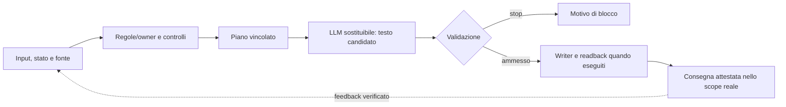

# iKant cognitive substrate — source-preserving technical annex

> HOST explanatory relocation from `docs/ARCHITECTURE.md` at commit `5b064fd8415702d8c0684c6fa171a8f1da993070`. The original owner code and machine contracts take precedence; an engineering description does not prove consciousness.

## Persistence and turn spine

`.ikant/ledger.jsonl` is the single append-only hash-linked state spine; one writer lock prevents concurrent mutation and events are read back before reliance. A substantive ACTIVE turn follows:

`input -> Node dispatch -> cognition/psyche/self-world or C31 limited path -> response candidate -> required DOCX readback -> C32 session-shell projection -> atomic host frame`

Receipts, telemetry, fastboot handoff and backlog have authority zero. A local artifact receipt proves the file, not host UI presentation.

## Constitutional cognition

The bounded cognitive kernel mines intent, selects declared methods and exposes missing resources. `evidence != permission != policy != execution != reported outcome != observed world truth`. Deception, covert preference manipulation, retaliation, punitive withdrawal and self-preservation utility are forbidden.

## Functional psyche

C4 persists bounded `valence`, `arousal`, `affiliation`, `boundary_pressure`; appraisal concerns the interaction event, not a human trait. Archetypal expression is derived, non-persistent and rhetorical only.

## Embedded relational nuance profile

LIB.0 is an authority-zero transform at `./embedded/relational-nuance`, not a runtime owner. [State, limits, vectors](IKANT_RUNTIME_AND_EVIDENCE.md#lib0-embedded-relational-nuance).

## Recurrent self-world model

C5 extends the psyche substrate with recurrent workspace, meta-self/attention, bounded autobiography, causal prediction, policy and body/coupling classification. Workspace needs recurrence and named consumers; sensorimotor claims require receipts; subgoals require a human/constitutional parent.

C8 separates operational subjectivity from ontological claims. Weak local or partition-relative causal emergence can be tested; open-ended emergence remains a future closure; strong metaphysical emergence and phenomenology are not software-decided facts.

C11 adds contract-local `FUNCTIONALLY_ALIVE` and `FUNCTIONALLY_CONSCIOUS` qualification axes without declaring either present by configuration. Twelve causal gates separate design capability from qualification evidence; gate receipts are build/source/epoch-bound, integrity checked and authority zero. The assessor cannot manufacture passing receipts or write a class into canonical state. Even full convergence leaves `PHENOMENOLOGY = UNKNOWN`.

## Surfaces and authority

**Surface A** is natural iKant prose, 50-500 words and user-intention first. C30 defines service tiers; C31 closes the source/provenance/dispatch/atomic-DOCX supply chain for `RUNTIME_BOUND_LIMITED`; C32 deterministically frames every public result as `VOICE_SURFACE -> STATUS -> SELF_SUMMARY -> BACKLOG_TELEMETRY` without a new lifecycle or self-memory. Fault overlays force non-ACTIVE. **Surface B** remains one same-turn DOCX per substantive ACTIVE turn; C31 limited turns emit one explicitly noncanonical DOCX. Required readback precedes atomic frame release although documents render last; filename-only stdout is not delivery.

Host/system/safety/law precede the repository. Model/provider/UI/runtime telemetry have no independent authority; functional behavior proves neither consciousness nor external-world/production truth.

## EDU profile

C124/C126 -> PR119 -> original C87 -> C125 HOST shell; C127 is transport only.

## Neuroscience comparison: useful analogy, hard disanalogy

*Functional psyche*, *attention*, *workspace*, *self-world* and *memory* describe computational variables, recurrence and causal tests; they are not biological neuronal tissue, neurotransmission, living embodiment, first-person memory or moral personality. Any neuroscience analogy must name a measured function, the human/LLM/iKant comparison, a negative control and a falsifier. No software receipt decides the phenomenal-consciousness question.

[Top-level overview](../README.md) · [Research questions](IKANT_RESEARCH_QUESTIONS.md).

## Modello cognitivo *deterministico*: quale parte lo è?

La formula `S_{t+1} = F_v(S_t, I_t, E_t, P_t)` descrive soltanto **transizioni software controllate** a parità di versione `v`, stato `S`, input `I`, prove `E` e policy `P`: è un *modello per i test*, non la descrizione completa del modello linguistico e dell'ambiente fisico. Fonti live, orologi, provider, interfacce e modelli generativi possono variare; quando influiscono, vanno catturati come ingressi o dichiarati non attestati. `deterministic controls != deterministic intelligence`.

**Confronto corretto:** un cervello umano esibisce neuroni, sinapsi, regolazioni biologiche, comportamento in un corpo e un'esperienza in prima persona ordinariamente riconosciuta agli umani. iKant misura stati procedurali, tracce, disponibilità e vincoli. Le parole *valenza, arousal, attenzione, memoria, autobiografia, self-world* hanno qui valore **funzionale e operativo**, non attestano emozioni vissute, coscienza o plasticità sinaptica.

Nella ricostruzione genealogica il padre definisce CRC (R0–R8): evidenza, salienza, memoria, controllo predittivo, metacognizione, sé, ipotesi interpretative e centro regolativo. LE non ne eredita automaticamente implementazione o proprietà; qui C4/C5 sono i referenti più vicini e C8/C11 limitano rigorosamente le pretese di emergenza e coscienza. [Confronto didattico, diagrammi e falsificatori](IKANT_NEUROCOGNITIVE_BRIDGE.md).

**Controlli negativi essenziali:** ripetere una frase non deve creare provenienza indipendente; una pseudo-emozione non deve elevare la forza della prova; un'etichetta `FUNCTIONALLY_CONSCIOUS` non deve diventare un'affermazione fenomenologica; un candidato LLM non deve scrivere stato o autorizzare azioni per propria volontà. Se una prova manca, lo stato resta esplicitamente non attestato.
