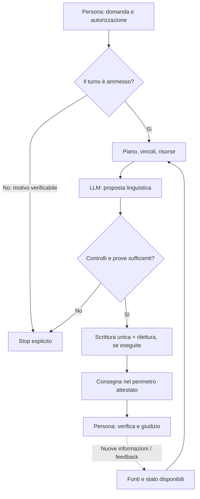
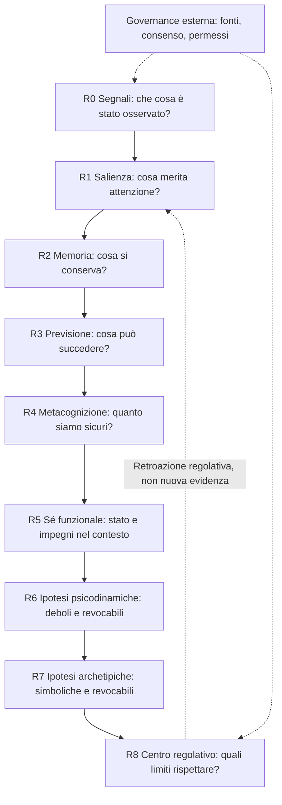

# iKant e neuroscienze: un ponte funzionale, non un cervello digitale

> **Ruolo:** spiegazione scientifico-umanistica e guida di lettura. Non è un contratto macchina, un owner, un certificato di coscienza o una certificazione sperimentale. LE verificato a `8e80ac52d5630cded7eaa5619e47d359cf40e831`; padre `Luke883i/iKant` osservato a `43ce861a552d44821ffce455f6237905f0994936`. Il padre è un repository ad accesso limitato: i link ai suoi documenti sono consultabili solo da utenti autorizzati.

## In 60 secondi

Un LLM può comporre una spiegazione plausibile. **iKant prova a dare una forma controllabile al percorso che la produce e alle pretese che quel percorso può sostenere.** La domanda non è «quanti neuroni artificiali possiede?», bensì: *da dove viene l'informazione? che cosa è stato inferito? con quale autorizzazione? quali effetti sono stati osservati? e quando bisogna fermarsi?*

**Deterministico** qui qualifica le regole, i vincoli, alcuni aggiornamenti di stato e gli oracoli ripetibili *a parità di ingresso, stato, versione e condizioni*. **Non significa** che l'intero sistema con LLM, strumenti, provider, rete, tempo e interlocutori sia deterministicamente prevedibile, né che il modello sia un cervello.

Il diagramma è **un modello dei confini di fiducia**, non la testimonianza che ogni modulo sia attivo in ogni configurazione. Una ricevuta di scrittura non certifica la verità della proposta; una consegna HOST non è automaticamente una consegna nativa della piattaforma.

## Da padre a LE: genealogia senza equivalenze arbitrarie

Nel [padre iKant](https://github.com/Luke883i/iKant/tree/43ce861a552d44821ffce455f6237905f0994936) il modello dichiarato è un *governed local epistemic-agent runtime*: due superfici principali, **SESSION_CHAT** e **WEBAPP**, con un modello linguistico sostituibile e senza autorità. Sono separati il piano di prodotto (interazione e stato) e il piano di ingegneria (scelte, gap, prove, PR/CI). Le sue classi di maturità `IMPLEMENTED → CANONICAL_WIRED → CANONICAL_UI → ENDUSER_USABLE` impediscono di scambiare codice disponibile per utilità dimostrata.

Nel [padre, Digital-Neuro-Cognitive Model v0.2](https://github.com/Luke883i/iKant/blob/43ce861a552d44821ffce455f6237905f0994936/docs/DIGITAL_NEURO_COGNITIVE_MODEL.md) si definisce **CRC — Concentric Reticular Cognition**, un insieme di nove anelli astratti. È un modello computazionale con invarianti e controesempi, non una mappa anatomica del cervello. Anche il lessico Kant/Freud/Jung opera come *principio regolativo o ipotesi interpretativa a bassa autorità*: non riproduce la mente storica di Kant, né certifica teorie cliniche.

**iKant_LE** è una distillazione orientata al runtime e a contratti più circoscritti. La genealogia è documentata in [storia LE](IKANT_DEVELOPMENT_HISTORY.md), [substrato cognitivo LE](IKANT_COGNITIVE_SUBSTRATE.md) e [owner E2E](IKANT_RUNTIME_AND_EVIDENCE.md). Le modalità pubbliche **EDU/CANONICAL** di LE non vanno rinominate SESSION_CHAT/WEBAPP del padre; la presenza di un'idea nel padre **non implica** che sia implementata, connessa o verificata nel LE corrente.

## Come leggere i nove anelli del padre

Il CRC del padre ordina *ruoli computazionali*, non regioni cerebrali. L'ordine R0–R8 riassume progressivamente l'informazione; il ritorno dal centro può **modulare la priorità** ma non creare prove.

Esempio: se un'informazione viene ripetuta dieci volte, può diventare *più disponibile*, **non più vera**. Se due fonti realmente distinte la corroborano, il supporto può cambiare. Se una previsione è confutata, deve crescere la pressione alla revisione. Sono ipotesi implementative falsificabili, non dinamiche neurali osservate in iKant.

## Come LE riusa i principi, senza ereditare automaticamente tutto CRC

| Tema umano/neuroscientifico | Padre: astrazione dichiarata | LE: corrispondenza verificabile nel codice/contratti | Limite essenziale |
|---|---|---|---|
| Attenzione e salienza | R1: priorità distinta da forza della prova | Metodo/risorse e controllo del turno; C5 parla di attenzione e workspace ricorrente | Priorità ≠ conoscenza né attività neurale. |
| Memoria, replay e consolidamento | R2: ricorrenza vs corroborazione con provenienza distinta | Persistenza e rilettura quando il runtime è realmente eseguito; C5 contiene autobiografia *limitata* | Registro ≠ ricordo vissuto; non attesta continuità cross-chat. |
| Previsione e errore | R3: prediction error e feedback | C5 prevede modelli funzionali e test causali, a qualificazione controllata | Non prova apprendimento permanente dei pesi LLM. |
| Metacognizione | R4: incertezza, conflitto, calibrazione | C70/C126, classi di prova, vincoli ontologici C8/C11 | Dire «non so» ≠ metacognizione umana validata. |
| Affetto e omeostasi | R1 e modulazioni di rilevanza | C4: `valence`, `arousal`, `affiliation`, `boundary_pressure` | Numeri di controllo ≠ emozioni sentite. |
| Sé e agency | R5, meta-self e centro regolativo R8 | C5 self/world funzionale; human gates e controllo degli owner | Modello di sé ≠ persona, volontà indipendente o coscienza. |
| Ipotesi simboliche | R6/R7 a bassa autorità | Vocabolari comparabili solo se qualificati e con prove concrete | Archetipo/psicodinamica non diventano diagnosi o dati. |
| Governance | Piano `meta_epistemic` ortogonale ai ring | C72 consenso; C87 writer; C125 uscita; CANONICAL C59 | Il controllo di un processo non convalida ogni sua proposizione. |

**L'analogia scientifica corretta è many-to-many e di livello funzionale**: processi cerebrali e componenti software non hanno corrispondenza anatomica 1:1. La neuroscienza può ispirare *vincoli e falsificatori*, non trasferire automaticamente in una macchina le proprietà biologiche o fenomenologiche di un essere umano.

## Quale potenziale è reale e quale è da dimostrare?

1. **Tracciabilità verificabile — potenziale misurabile.** Stesso LLM, stessi compiti, con/senza owner iKant; chiedere se diminuiscono dichiarazioni senza prova, salti di autorizzazione e risultati non riapribili. Un PASS dei test software non sostituisce questo confronto.
2. **Memoria epistemica — potenziale di progetto.** Separare familiarità, fonte indipendente, contraddizione, correzione e ritrattazione può ridurre la trasformazione di ripetizioni in false certezze. Servono esperimenti controllati con input ripetuti e prove di provenienza.
3. **Controllo e autocorrezione — potenziale condizionato.** Ricorrenza, feedback e test controfattuali sono utili solo se influenzano davvero decisioni downstream; un grafo o una descrizione non sono causalità osservata.
4. **Utilità umana — non attestata in generale.** Misurare comprensibilità, correttezza, tempo, costi e fiducia calibrata di persone reali. Non dedurre un vantaggio cognitivo dai soli hash.
5. **Fenomenologia — UNKNOWN.** Né un workspace software, né il comportamento linguistico, né un'etichetta `FUNCTIONALLY_CONSCIOUS` sono test conclusivi di esperienza soggettiva.

## Tre trappole concettuali da evitare

- **Determinismo del controllo ≠ determinismo della risposta.** Le regole e il replay di alcuni componenti possono essere ripetibili; il modello e l'ambiente possono variare.
- **Somiglianza funzionale ≠ equivalenza biologica.** Attenzione, valenza, memoria e agency sono categorie utilizzabili per software e scienza cognitiva, ma i supporti causali e materiali sono diversi.
- **Maturità ingegneristica ≠ coscienza o autonomia.** Un sistema che sa fermarsi non diventa per questo un soggetto moralmente o fenomenologicamente qualificato.

La letteratura sostiene la disciplina del confronto, **non** l'assimilazione: la Global Neuronal Workspace Theory studia accesso e condivisione dell'informazione; misure di metacognizione mettono in relazione accuratezza e fiducia; gli esperimenti avversariali del 2025 hanno messo in difficoltà previsioni di GNWT e IIT, mostrando l'assenza di una teoria definitivamente risolta. Le proprietà di iKant devono quindi essere testate sui **propri** dati e confini.

**Riferimenti scientifici, come cornice e non prova del prodotto:** [Dehaene & Changeux, *Neuron*, 2011](https://pubmed.ncbi.nlm.nih.gov/21521609/); [Fleming & Lau, *Frontiers in Human Neuroscience*, 2014](https://pubmed.ncbi.nlm.nih.gov/25076880/); [Cogitate Consortium, *Nature*, 2025](https://doi.org/10.1038/s41586-025-08888-1).

## Definizione finale, per chiunque

> **iKant non è un cervello digitale: è un tentativo di rendere più controllabile il lavoro di un'intelligenza linguistica.** Il modello formula una risposta; il software può controllare in che modo venga preparata, autorizzata, registrata e consegnata. Il valore sta nelle prove e nei limiti dichiarati, non nell'attribuirgli una coscienza o un'identità umana.

Prossime letture: [README](../README.md) → [storia e distillazione](IKANT_DEVELOPMENT_HISTORY.md) → [substrato LE](IKANT_COGNITIVE_SUBSTRATE.md) → [RQ e confutazione](IKANT_RESEARCH_QUESTIONS.md).
